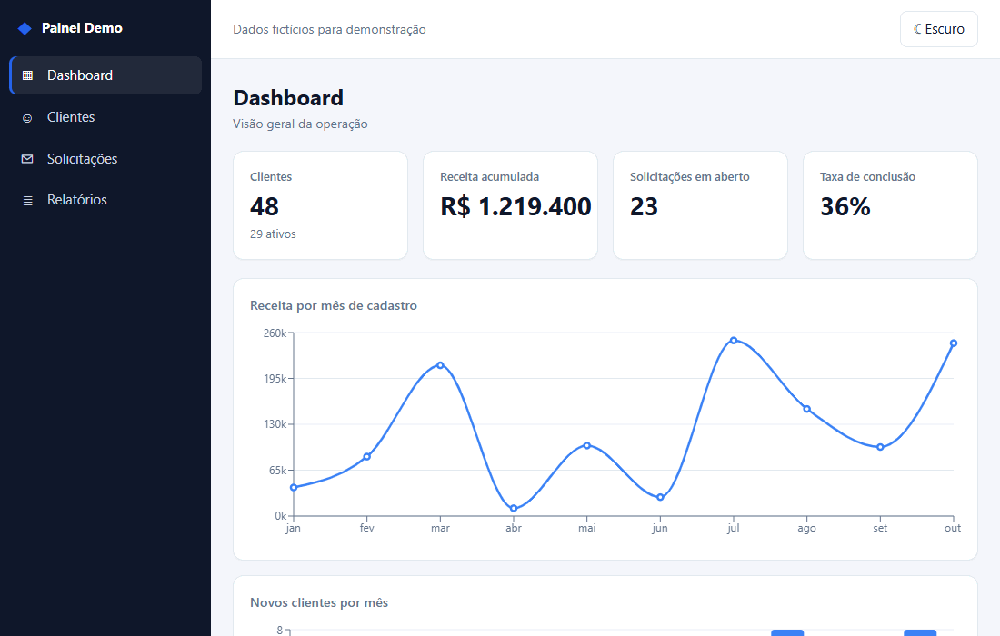
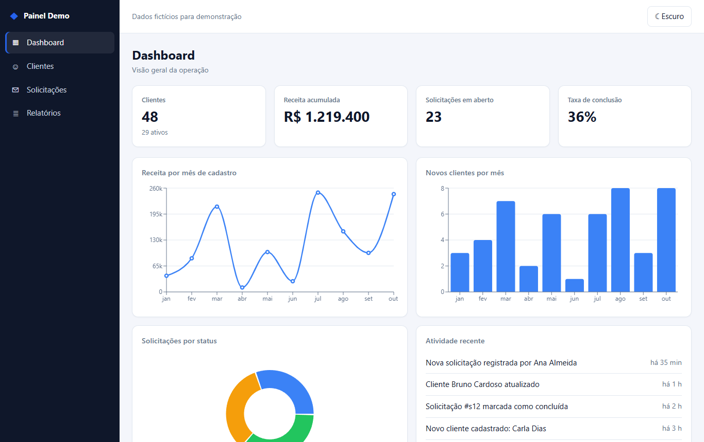
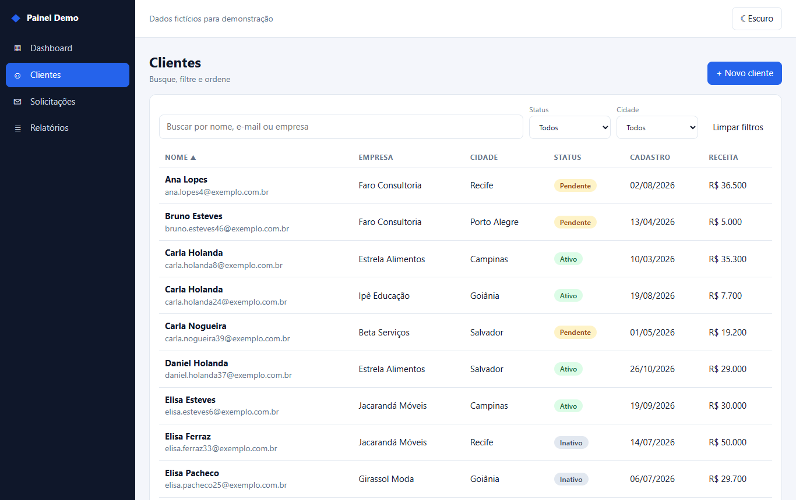
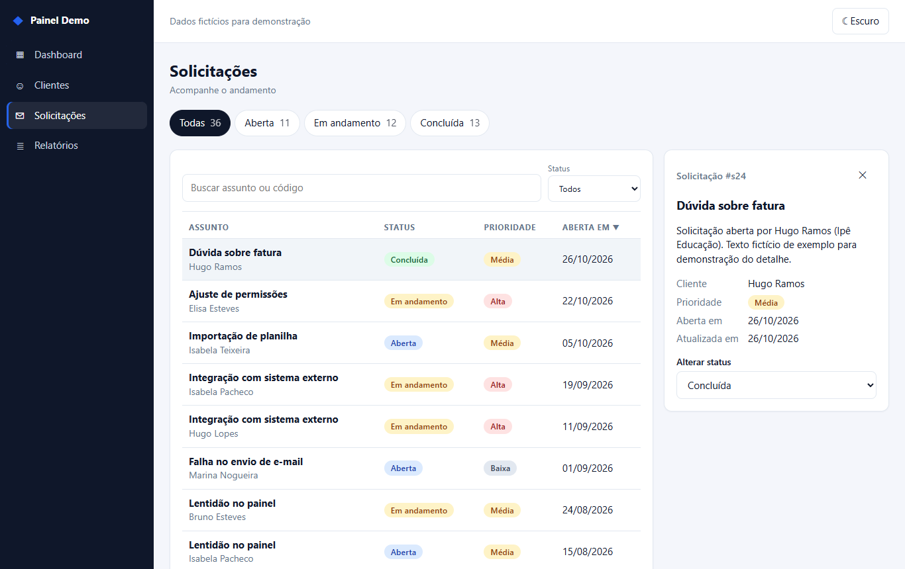
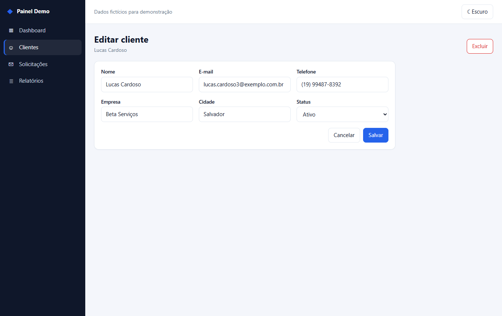
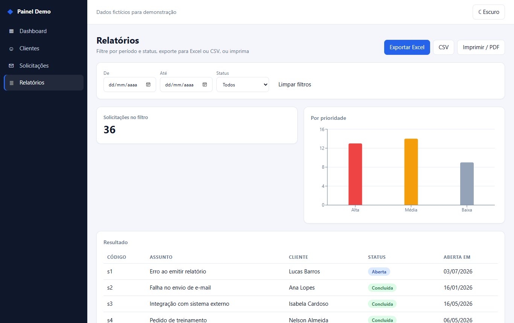
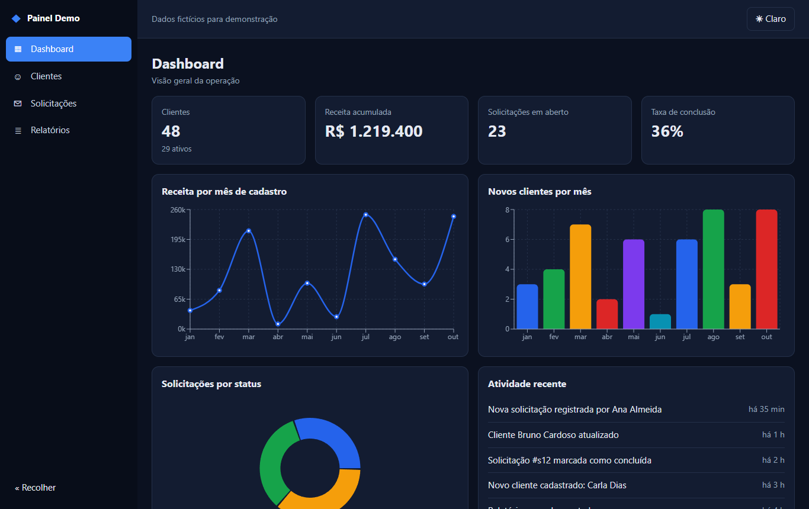

# Dashboard Admin Demo

Painel administrativo genérico em **React 19 + TypeScript (Vite)**. Todos os dados são fictícios e simulados em memória, atrás de uma camada de repositório, sem backend. Trocar por uma API real exige só uma nova implementação da interface `Repository`.

**Demo ao vivo (roda no navegador):** https://porzelt.github.io/dashboard-admin-demo/



Arquitetura em camadas (domínio puro, repositório atrás de uma interface, componentes reutilizáveis, telas), estado com Context + hooks e **32 testes** (Vitest + Testing Library) cobrindo busca, filtros, ordenação, paginação, exportação Excel e CSV, validação do formulário e as telas de clientes e solicitações.

## Funcionalidades

1. **Dashboard**: indicadores (KPIs), gráficos de linha, barras e pizza (Recharts) e atividade recente.
2. **Clientes**: tabela com busca (ignora acentos), filtros por status e cidade, ordenação por qualquer coluna e paginação.
3. **Solicitações**: acompanhamento por status (aberta, em andamento, concluída) com abas de contagem, busca e painel de detalhe com troca de status.
4. **Cadastro e edição de cliente**: formulário com validação (react-hook-form + zod), criar, editar e excluir.
5. **Relatórios**: filtros por período e status, exportação **Excel (.xlsx)** com cabeçalho formatado, colunas ajustadas, datas reais e cabeçalho fixo; exportação **CSV** para integrações; e **impressão/PDF** com folha de estilo de impressão.

Extras: menu lateral recolhível (gaveta no celular), tema claro/escuro salvo no navegador, tabelas que viram cartões em telas pequenas, layout mobile-first e navegação por teclado.

| Dashboard | Clientes | Solicitações |
|---|---|---|
|  |  |  |

| Cadastro | Relatórios | Tema escuro | Celular |
|---|---|---|---|
|  |  |  |  |

## Como rodar

```bash
npm install
npm run dev
```

- Testes: `npm test`
- Checagem de tipos: `npm run typecheck`
- Lint: `npm run lint`
- Build de produção: `npm run build` (saída em `dist/`)
- Capturas e GIF: `npm run build`, `npx vite preview --port 4173` e, em outro terminal, `node scripts/capturas.mjs` (usa o Edge instalado via playwright-core)

O CI (GitHub Actions) roda tipos, lint, testes e build a cada push; o workflow `pages.yml` publica o `dist/` no GitHub Pages.

## Estrutura

```
src/
  main.tsx                  # composição: escolhe o repositório e monta o app
  App.tsx                   # roteamento por hash (#/clientes/c1)
  state.tsx                 # DadosProvider: carrega dados e expõe ações
  domain/                   # regras puras, sem dependência de UI
    types.ts                # Cliente, Solicitacao, status
    consulta.ts             # buscar, ordenar, paginar, período
    consultas.ts            # consultas específicas de clientes e solicitações
    csv.ts                  # geração e download de CSV
    planilha.ts             # geração do .xlsx (células tipadas, larguras)
    validacao.ts            # schema zod do formulário
    indicadores.ts          # KPIs e agregação por mês
  data/
    Repository.ts           # interface (contrato)
    MockRepository.ts       # implementação em memória com latência simulada
    seed.ts                 # dados fictícios determinísticos
  components/               # Table, Paginacao, FilterBar, Card, Kpi, gráficos, ClienteForm, Layout
  pages/                    # Dashboard, Clientes, ClienteEditar, Solicitacoes, Relatorios
  __tests__/                # regras de domínio, CSV, validação e telas
scripts/capturas.mjs        # gera docs/screens e docs/demo.gif
```

## Decisões

- **Repositório atrás de interface**: a UI só conhece `Repository` (`listarClientes`, `salvarCliente`, `atualizarStatus`…). Para um backend real (REST, Laravel, NestJS), basta criar `ApiRepository` com `fetch` e trocar uma linha em `main.tsx`.
- **Regras puras em `domain/`**: busca, ordenação, paginação, CSV e validação são funções sem React, fáceis de testar e reaproveitar no servidor.
- **Roteamento por hash** sem biblioteca: funciona no GitHub Pages sem configuração de servidor e mantém o bundle enxuto.
- **Excel nativo, carregado sob demanda**: o `.xlsx` é gerado com `write-excel-file` (leve, sem as vulnerabilidades do pacote `xlsx` do npm), importado só no clique de exportar, num pedaço separado do bundle. Datas vão como data do Excel (filtráveis e ordenáveis) e texto vai como texto, então nada vira fórmula.
- **CSV com `;`, BOM e CRLF**: abre direto no Excel em português com acentos corretos; células que começam com `=`, `+`, `-` ou `@` são neutralizadas contra injeção de fórmula.
- **Tema por variáveis CSS**: claro/escuro sem duplicar estilos; segue a preferência do sistema na primeira visita.
- **Dados determinísticos**: o seed usa um gerador pseudoaleatório com semente fixa, então testes e capturas são reproduzíveis.
